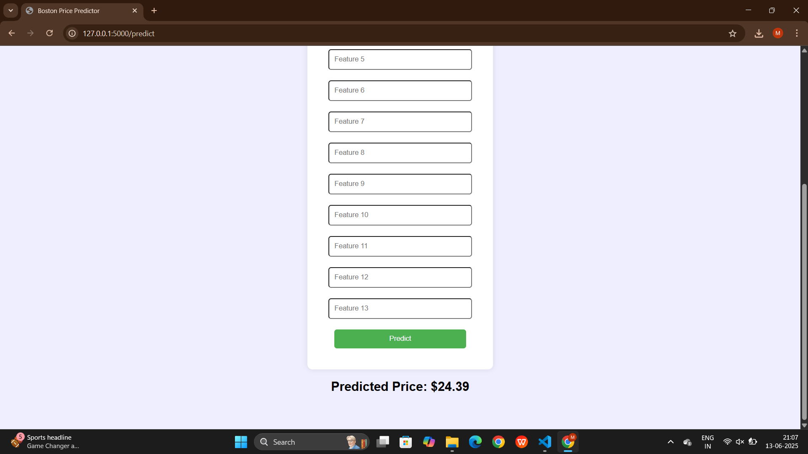

# TerraVista AI

**Read the shape of a place.**

TerraVista AI is an editorial-style Flask application for exploring the original Boston Housing dataset through a Linear Regression model. It is an educational experiment in reading relationships between historical housing features and `medv`, the dataset's median home value target.

## Features

- Responsive TerraVista editorial interface with topographic-inspired SVG/CSS visuals.
- Separate pages for the landing experience, property estimate, model notes, and recent readings.
- Prediction workspace using the model's actual 13 input features.
- Animated estimate reveal and session-scoped history of the five most recent predictions.
- Held-out evaluation metrics, actual-versus-predicted chart, and coefficient context.
- Accessible focus states, form validation, reduced-motion support, and mobile layouts.
- No database or frontend framework required.

## Tech stack

Python, Flask, scikit-learn, pandas, NumPy, HTML, CSS, and vanilla JavaScript.

## Installation and run

From the project directory:

```powershell
python -m venv .venv
.\.venv\Scripts\Activate.ps1
python -m pip install flask scikit-learn pandas numpy
python model.py
python app.py
```

Open <http://127.0.0.1:5000/>.

## Deploy on Render

1. Push the contents of this project directory to a GitHub repository.
2. In Render, choose **New +** → **Web Service**, connect the repository, and set the root directory to `boston-price-prediction` if the repository contains the parent folder.
3. Use:
   - Build command: `pip install -r requirements.txt`
   - Start command: `gunicorn app:app`
4. Add the environment variable `FLASK_SECRET_KEY` with a long random value.
5. Click **Create Web Service**. Render will provide a public `onrender.com` URL after the first deploy.

Keep `app.py`, `model.pkl`, `boston.csv`, `templates/`, and `static/` in the deployed project directory.

The main pages are:

- `/` — editorial landing page
- `/estimate` — real 13-feature prediction form
- `/model-notes` — held-out metrics and chart
- `/recent` — session-scoped prediction history

If PowerShell blocks activation, run the Python executable directly:

```powershell
.\.venv\Scripts\python.exe model.py
.\.venv\Scripts\python.exe app.py
```

## Model evaluation

`model.py` trains the deployed `LinearRegression` model on an 80/20 split with `random_state=42` and writes `model.pkl`. The app independently evaluates a Linear Regression model on the same reproducible held-out split. It reports Mean Absolute Error (MAE), Root Mean Squared Error (RMSE), and R²; these are not accuracy percentages and should not be interpreted as a guarantee.

The target `medv` is expressed in thousands of 1970s-era dollars. The application keeps that unit and displays estimates as `$X.XXk`.

## Dataset limitations

This is the historical Boston Housing dataset (506 rows, 13 predictors). It is not a reliable source for current Boston property values. It has serious ethical limitations, including a problematic racial variable represented by the source feature `B`. TerraVista retains the original feature set for reproducibility and explicitly flags it in the interface; it should not be used for lending, pricing, eligibility, or decisions about people and communities.

Predictions are educational estimates from historical data, not appraisals, investment advice, or guaranteed market values.

## Screenshots



## Future improvements

- Replace the historical dataset with a documented, contemporary, ethically reviewed source.
- Add a versioned preprocessing pipeline and model registry.
- Add automated tests and uncertainty intervals.
- Offer opt-in, privacy-reviewed persistence for saved explorations.

## Author

[Monisha Krishnamoorthy](https://github.com/monishakrishnamoorthy7)
